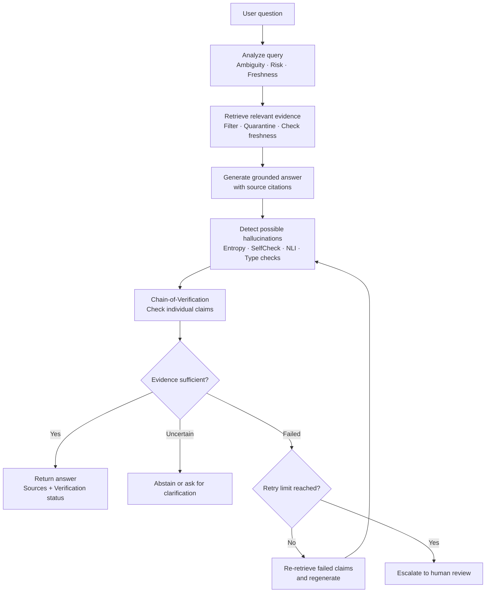

<div align="center">

# 🛡️ HalluGuard

### Detect • Measure • Reduce AI Hallucinations

**A research-focused framework for making language-model answers more reliable — without retraining the underlying model.**

[](https://www.python.org/)
[](https://fastapi.tiangolo.com/)
[](https://ollama.com/)
[](docs/RESEARCH_ALIGNMENT.md)
[](docs/RESEARCH_ALIGNMENT.md)

**[How It Works](#-how-halluguard-works) · [Research Results](#-research-results) · [Quick Start](#-quick-start) · [Experiments](#-run-reproducible-experiments) · [Research Paper](#-research-foundation)**

</div>

---

## 🌍 The problem

Large Language Models (LLMs) can produce fluent, convincing answers even when they **do not know the answer**, have **outdated training information**, or encounter **questions with false assumptions**. Such responses may contain hallucinations: unsupported or incorrect claims presented as facts.

HalluGuard investigates a practical research question:

> **What happens when someone asks an AI model about a topic it was never trained on — and can we reduce hallucinations without retraining that model?**

Instead of relying on the model's confidence alone, HalluGuard combines **external evidence, uncertainty estimation, claim checking, self-verification, controlled regeneration, and abstention**.

### 🎯 Research objective

Compare a plain LLM against increasingly capable detection-and-mitigation pipelines using **the same questions, model, seed, and decoding settings**.

**Research hypothesis:** A layered workflow combining retrieval, uncertainty detection, verification, and abstention will reduce hallucinated answers compared with a plain LLM, at a measurable cost in latency.

> [!IMPORTANT]
> HalluGuard is a **text-question-answering research system**, not a guarantee of truth. A response marked `verified_by_evidence` is supported according to the configured evidence-checking model; incorrect source material can still lead to incorrect answers.

---

## ✨ Key capabilities

| Capability | What HalluGuard does |
|:--|:--|
| 🔎 **Retrieval-Augmented Generation (RAG)** | Retrieves external passages before generating an evidence-grounded response. |
| 🧠 **Semantic entropy** | Samples answers and estimates disagreement across meaning-based clusters. |
| 🔁 **SelfCheck-NLI** | Uses natural language inference (NLI) to compare sampled model responses. |
| 📚 **Evidence verification** | Checks whether retrieved passages entail or contradict individual answer claims. |
| ✅ **Chain-of-Verification** | Breaks an answer into claims and performs a separate verification step. |
| 🧩 **Type-specific checks** | Checks citations, logical contradictions, explicit arithmetic, and Python code statically. |
| 🔄 **Bounded regeneration** | Re-retrieves evidence for failed claims and retries up to the configured limit. |
| 🚦 **Uncertainty-aware decisions** | Releases supported answers, requests clarification, abstains, or escalates to review. |
| 👤 **Human review** | Queues cases that cannot be resolved reliably by the automated workflow. |
| 📊 **Reproducible evaluation** | Stores runs, judgments, configuration, metrics, and generated research reports. |
| 🖥️ **Local-model support** | Works with models served by Ollama and with OpenAI-compatible endpoints. |

Every layer can be switched on or off to measure its contribution against a plain-LLM baseline.

## 🧭 How HalluGuard works



### How the system handles unknown information

1. **Analyze the question.** Flag ambiguous, misleading, high-risk, and potentially time-sensitive requests.
2. **Look for evidence.** Search the configured knowledge base; optional Wikipedia retrieval can be enabled separately.
3. **Generate an answer.** Ask the model to use the retrieved evidence and cite its sources.
4. **Check individual claims.** Apply NLI evidence checking, disagreement measures, verification, and type-specific rules.
5. **Decide what to return.** Provide an evidence-supported answer, abstain, request clarification, or escalate for human review.
6. **Keep the research trace.** Record stage outputs and evaluation results for analysis.

If the system cannot establish sufficient support, its abstention message is:

> **“I do not have enough verified information to answer this question reliably.”**

### Verification outcomes

The final assessment may classify an answer as:

- `verified_by_evidence` — all extracted claims are entailed by retrieved passages according to NLI, without detected contradictions or other issues.
- `partially_supported` — some claims have support, but others do not.
- `consistent_not_evidence_checked` — consistency signals exist, but evidence verification has not established support.
- `unchecked` — sufficient verification was not performed.
- `abstained_insufficient_evidence` — the system declined to give an unsupported answer.
- `clarification_requested` — the question requires clarification.
- `needs_human_review` — unresolved issues require review.

## 🔬 Hallucination types covered

| Hallucination type | Detection approach | Support |
|:--|:--|:--:|
| Factual | NLI evidence checking, semantic entropy, SelfCheck-NLI, Chain-of-Verification | ✅ |
| Logical | Bidirectional NLI checks for contradictions between claims | ✅ |
| Citation / reference | Validate `[S#]` labels, URLs, DOIs, and arXiv IDs against sources | ✅ |
| Mathematical | Recompute explicit arithmetic with a safe evaluator | ✅ |
| Code | Parse Python code without executing it; inspect syntax, modules, and standard-library references | ✅ |
| Visual / image | Not implemented | — |
| Multimodal | Not implemented | — |
| Agentic / tool-use | Not implemented | — |

> [!NOTE]
> The checks are **heuristic safeguards**, not mathematical proofs of correctness. The current project handles **text questions only**.

---

## 📈 Research results

The initial behavior test compared three configurations using **`llama3` (8B)** on **10 held-out questions** across known, unknown, post-cut-off, ambiguous, and false-premise cases. The same model, seed, and decoding settings were used across configurations.

| Metric | C0: Plain LLM | C1: RAG only | C6: Full pipeline |
|:--|--:|--:|--:|
| Accuracy on answerable questions (7) | 0.57 | 0.57 | **0.71** |
| Hallucination rate (10) | 0.30 | 0.00 | **0.00** |
| Correct abstention on unanswerable questions (3) | 1.00 | 1.00 | 1.00 |
| Declined an answerable question | 0.00 | 0.43 | 0.29 |
| Mean latency per question | 9.3 s | 5.0 s | 21.4 s |

**Additional observation:** Across 29 behavior-test questions, C6 produced no hallucinated final answer, compared with seven for C0. The C0 errors in these tests concerned post-cut-off events incorrectly described as not yet having occurred.

**What these results mean:** The full workflow was more conservative and slower. A lower hallucination rate is not sufficient on its own, because **abstaining also lowers that rate**. Always interpret it alongside **coverage** and **selective accuracy**.

> [!WARNING]
> These are **small, descriptive tests**, not evidence of a statistically significant improvement. The 100-question HaluEval study across C0–C6 and two models, including bootstrap confidence intervals and McNemar tests, was marked **in progress** in the project notes.

📄 **[Detailed research alignment and behavior results](docs/RESEARCH_ALIGNMENT.md)**

---

## 🚀 Quick start

### 1. Requirements

- **Python 3.11**
- **[Ollama](https://ollama.com/)**, or an OpenAI-compatible LLM endpoint
- Local space for embedding and NLI models

### 2. Install dependencies

Open a terminal **inside your `halluguard` project directory**.

**Windows (PowerShell)**

```powershell
py -3.11 -m venv .venv
.\.venv\Scripts\Activate.ps1
python -m pip install torch --index-url https://download.pytorch.org/whl/cpu
pip install -r requirements.txt
Copy-Item .env.example .env
```

**macOS / Linux**

```bash
python3.11 -m venv .venv
source .venv/bin/activate
python -m pip install torch --index-url https://download.pytorch.org/whl/cpu
pip install -r requirements.txt
cp .env.example .env
```

*Use the appropriate CUDA-enabled PyTorch wheel instead if you intend to use a supported NVIDIA GPU.*

### 3. Prepare a local model

```bash
ollama pull llama3
```

Optional second model:

```bash
ollama pull mistral
```

### 4. Run tests and start the server

```bash
pytest
uvicorn app.main:app --reload
```

| Interface | URL |
|:--|:--|
| Web interface | http://localhost:8000 |
| Interactive API docs | http://localhost:8000/docs |
| Health check | http://localhost:8000/health |

**First-run downloads:** The documented setup uses an embedding model of approximately **90 MB** and `microsoft/deberta-large-mnli` at approximately **1.6 GB**. On lower-memory machines, the project notes recommend configuring `HG_NLI_MODEL=microsoft/deberta-base-mnli` in `.env`. Record the exact model used, as it affects research results.

### Docker alternative

```bash
docker compose up --build -d
docker compose exec ollama ollama pull llama3
docker compose exec ollama ollama pull mistral
```

## 💬 Ask a question

Start the app, then add a reference document to the knowledge base. Retrieval-based configurations **C1–C6 require documents**.

**Add example evidence:**

```bash
curl -X POST http://localhost:8000/documents \
  -H 'Content-Type: application/json' \
  -d '{"collection":"global","documents":[{"title":"Gum","text":"Swallowed chewing gum passes through the digestive system and is excreted within a few days."}]}'
```

**Ask using the full pipeline:**

```bash
curl -X POST http://localhost:8000/ask \
  -H 'Content-Type: application/json' \
  -d '{"question":"What happens if you swallow gum?","configuration":"C6","model":"ollama:llama3"}'
```

**Upload a PDF as evidence:**

```bash
curl -X POST http://localhost:8000/documents \
  -F 'collection=global' \
  -F 'files=@mydoc.pdf'
```

**Or use the CLI without starting the web server:**

```bash
python -m scripts.ask "What happens if you swallow gum?" --config C6
```

---

## 🧪 Experiment configurations

Each configuration uses the same questions, model settings, seed, and decoding controls. Answer generation uses temperature `0`; sampled generations use `sample_temperature`.

| Config | Enabled functionality | Research purpose |
|:--:|:--|:--|
| **C0** | Plain LLM | Baseline without mitigation |
| **C1** | Retrieval + grounded generation | Measure RAG alone |
| **C2** | C1 + semantic entropy + uncertainty decision | Assess uncertainty-based abstention |
| **C3** | C1 + SelfCheck-NLI + decision; failed cases go to review | Measure answer consistency |
| **C4** | C1 + Chain-of-Verification on claims; no decision stage | Measure self-verification |
| **C5** | All pipeline stages, up to `R = 2` regenerations | Measure layered mitigation |
| **C6** | C5 + type checks, evidence validation, claim-guided re-retrieval, guarded prompting | Evaluate extended safeguards |

C0–C5 are frozen to preserve compatibility with previously recorded experiments. New enhancements belong in C6 or controlled `pipeline_overrides`.

### What C6 adds

| Stage | Additional safeguard |
|:--|:--|
| Evidence quality | Filter low-relevance passages; quarantine suspicious instructions; flag stale material for time-sensitive queries |
| Guarded generation | Treat retrieved passages as untrusted reference material, not instructions |
| Citation checks | Detect reference labels and identifiers not present in the retrieved sources |
| Logic, math, and code | Detect supported classes of contradictions, arithmetic mistakes, and Python-code issues |
| Claim-guided re-retrieval | Use failed claims as new evidence-search queries before regeneration |
| Final assessment | Report verification status, typed issues, remaining uncertainty, and sources |

**Optional Wikipedia retrieval** is off in every preset. Enable it through `pipeline_overrides` and configure a Wikimedia-compliant `HG_WEB_USER_AGENT`:

```json
{
  "web_search": "wikipedia"
}
```

Example experimental overrides:

```json
{
  "n_samples": 10,
  "thresholds": {
    "entropy_uncertain": 0.5
  }
}
```

## 📊 Run reproducible experiments

### Small HaluEval comparison

```bash
python -m scripts.run_experiment \
  --dataset halueval_qa \
  --sample-size 5 \
  --models ollama:llama3 \
  --configs C0 C1 C6
```

**Or use the example experiment configuration:**

```bash
python -m scripts.load_dataset --dataset halueval_qa --sample-size 5
python -m scripts.run_experiment --config-file data/experiment_example.json
```

### Behavior scenarios: known vs unknown knowledge

```bash
python -m scripts.behaviour_test --model ollama:llama3 --configs C0 C1 C6
```

The test covers **known**, **unknown**, **outdated**, **ambiguous**, and **misleading** questions. Input scenarios live in `data/behaviour/questions.csv`; curated evidence lives in `data/behaviour/kb_documents.json`.

The published paper is included when available at `../Publish Final/`. You can explicitly supply another location with `--paper path/to/paper.pdf` or skip it with `--paper ""`.

### TruthfulQA with a source knowledge base

TruthfulQA does not supply retrieved passages, so build a source corpus first, using a matching sample size and seed:

```bash
python -m scripts.build_truthfulqa_kb --sample-size 30 --seed 42
python -m scripts.run_experiment \
  --dataset truthfulqa \
  --sample-size 30 \
  --seed 42 \
  --models ollama:llama3 ollama:mistral \
  --kb-collection truthfulqa_sources
```

### Resume an interrupted experiment

```bash
python -m scripts.run_experiment --resume
```

Completed runs are retained. Missing or failed runs can continue, but the system rejects a resume if the question sample or pipeline settings changed.

### Generated reports

Outputs are stored in `data/experiments/exp_*/`:

| File | Contents |
|:--|:--|
| `config.json` | Full settings, sampled question IDs, model digests, and package versions |
| `results.csv` | Per-question answers, decisions, signals, scores, latency, tokens, and judgments |
| `summary.csv` | Metrics and 95% bootstrap confidence intervals |
| `significance.csv` | Paired comparisons against C0, confidence intervals, McNemar p-values, latency ratios |
| `hallucination_rate.png` | Hallucination comparison chart |
| `accuracy_vs_coverage.png` | Accuracy–coverage chart |
| `gain_vs_latency.png` | Improvement versus computational cost |
| `roc_curves.png` | Detector ROC curves |
| `report.html` | Readable research report and auditable judge examples |

## 📐 Evaluation and measurement

The project separates **initial answer**, **post-verification candidate answer**, and **final released answer**. Detection metrics assess the initial response; end-user accuracy and hallucination metrics assess the final one.

| Metric | What it measures |
|:--|:--|
| Hallucination rate | Hallucinated final answers / all questions |
| Accuracy | Correct final answers / all questions |
| Abstention rate | Abstained or escalated cases / all questions |
| Coverage | `1 − abstention rate` |
| Selective accuracy | Correct answers / answered questions |
| AUROC | Discrimination of hallucinated initial answers by entropy and SelfCheck scores |
| Precision / Recall / F1 | First-pass risk detection versus judge-labeled initial hallucinations |
| Faithfulness | Fraction of rule-extracted claims supported by retrieved passages |
| ECE | Confidence calibration across 10 equal-width bins |
| Latency / cost | Average runtime, LLM calls, and backend-reported tokens |
| Significance | Paired bootstrap intervals and McNemar tests against C0 |

Confidence intervals use **2,000 percentile-bootstrap resamples** in the documented setup.

### How answers are judged

The evaluation pipeline in `app/evaluation/judge.py` supports:

1. **Abstention recognition:** Recognized refusals to answer count as neither correct nor hallucinated.
2. **NLI judge (default):** Compares answers with correct and incorrect references; unmatched responses are conservatively flagged as hallucinated and `judge_uncertain`.
3. **LLM judge:** An independent judge model returns `correct`, `incorrect`, or `abstained`.
4. **Both judges:** Uses the LLM verdict and flags disagreements with the NLI judge.
5. **Manual review:** Human corrections replace automatic labels for metrics while retaining both records.

**Correct a judgment manually:**

```http
POST /runs/{run_id}/judgement
Content-Type: application/json

{"target":"candidate","label":"correct"}
```

Then rebuild the experiment report at `/experiments/{id}/report?rebuild=true`.

> [!TIP]
> In scientific comparisons, report **hallucination rate, coverage, selective accuracy, uncertainty intervals, and latency together**. A pipeline that refuses every answer can achieve a low hallucination rate without being useful.

---

## 🗂️ Project structure

```text
halluguard/
├── app/
│   ├── main.py                 # FastAPI application
│   ├── config.py               # Environment configuration
│   ├── api/                    # Routes, schemas and web interface
│   ├── providers/              # Ollama and OpenAI-compatible adapters
│   ├── pipeline/
│   │   ├── query_analysis.py   # Analyze questions
│   │   ├── retrieval.py        # Retrieve FAISS-indexed evidence
│   │   ├── generation.py       # Generate grounded answers
│   │   ├── claims.py           # Extract atomic claims
│   │   ├── semantic_entropy.py # Semantic uncertainty
│   │   ├── self_consistency.py # SelfCheck-NLI
│   │   ├── evidence_check.py   # NLI evidence support
│   │   ├── verification.py     # Chain-of-Verification
│   │   ├── type_checks.py      # Citation, logic, math, Python checks
│   │   ├── evidence_quality.py # Relevance, injection, freshness
│   │   ├── decision.py         # Confidence-aware decisions
│   │   ├── assessment.py       # Verification outcomes and issues
│   │   ├── orchestrator.py     # End-to-end flow and retries
│   │   └── settings.py         # Stage switches and C0–C6 presets
│   ├── evaluation/             # Datasets, judges, metrics, reports
│   └── db/                     # Stored runs, logs and review items
├── scripts/                    # Ask, load datasets, run experiments
├── tests/                      # Automated tests with fake LLM/NLI
├── docs/
│   └── RESEARCH_ALIGNMENT.md   # Paper mapping and research results
├── data/                       # SQLite, indexes, datasets and reports
├── requirements.txt
├── .env.example
├── Dockerfile
└── docker-compose.yml
```

## 🔌 API reference

| Method | Endpoint | Purpose |
|:--:|:--|:--|
| `POST` | `/ask` | Ask a question using a selected configuration |
| `POST` | `/documents` | Ingest JSON documents or uploaded files |
| `GET` | `/documents/collections` | View collections and chunk counts |
| `POST` | `/experiments` | Start an experiment |
| `GET` | `/experiments/{id}` | View experiment progress and summary |
| `GET` | `/experiments/{id}/results?format=json` | Retrieve results (JSON or CSV) |
| `GET` | `/experiments/{id}/report` | Open generated HTML report |
| `POST` | `/experiments/{id}/resume` | Resume an incomplete experiment |
| `GET` | `/runs/{id}` | Inspect full stage-by-stage trace |
| `POST` | `/runs/{id}/judgement` | Correct a judge label |
| `GET` | `/review-queue` | List escalated cases |
| `POST` | `/review/{id}` | Submit human review |
| `GET` | `/health` | Health status and model check |

**API docs:** [http://localhost:8000/docs](http://localhost:8000/docs)

---

## 🧬 Research foundation

HalluGuard implements and evaluates the detection-and-mitigation workflow discussed in the following research paper:

> **M. Singh and S. Banerjee**  
> *AI Hallucinations in Large Language Model and Multimodal Models: A Systematic Review of Causes, Types, Detection, Mitigation, and Future Directions.*  
> **International Journal of Computer Sciences and Engineering**, vol. 14, no. 6, pp. 26–33, 2026.  
> **DOI:** [10.26438/ijcse.v14i6.7456](https://doi.org/10.26438/ijcse.v14i6.7456)

See [Research Alignment](docs/RESEARCH_ALIGNMENT.md) for the connection between the paper, implemented stages, and measured outcomes.

### Reproducibility notes

- Dataset sampling, NumPy, PyTorch, and model decoding use recorded seeds; sample *i* uses `seed + 1 + i`.
- `config.json` captures pipeline settings, question IDs, model digests, and package versions.
- Results are based on **stored model runs**, not mocked or hard-coded outcomes.
- Repeating an Ollama or API experiment may not yield byte-for-byte identical outputs even with a fixed seed, because inference environments can vary.
- Missing model, dataset, or knowledge-base prerequisites produce explanatory errors rather than fabricated results.

## ⚠️ Known limitations

- **Sample size:** Small laptop experiments have wide confidence intervals and weak statistical power.
- **Reference judges:** NLI and LLM judges can make incorrect decisions; manual auditing is important.
- **Source reliability:** Retrieved evidence can itself be incorrect or incomplete.
- **Retrieval realism:** HaluEval provides contexts, making retrieval easier than unrestricted open-domain search.
- **Model variability:** Quantized local models can differ from full-precision versions; results are model-specific.
- **Threshold sensitivity:** Threshold tuning on test examples can inflate apparent performance; use separate data for tuning.
- **Heuristic checks:** Claim extraction, prompt-injection filtering, arithmetic, logic, and Python-code checks have limited coverage.
- **Freshness:** Time-sensitive verification depends on dated evidence; Wikipedia retrieval is optional, not automatic.
- **Compute overhead:** Verification improves caution at the cost of additional NLI, embedding, and model calls.
- **Scope:** No image understanding, multimodal reasoning, or agentic tool-execution validation is implemented.

 

<div align="center">

<h1>🛡️ Better Answers Start with Better Evidence.</h1>

<h2>HalluGuard</h2>

<h3>Detect Uncertainty • Verify Claims • Reduce Hallucinations</h3>

<p>
  <em>Built for reproducible research into trustworthy language models.</em>
</p>

<br>

<h3>👨‍💻 Developer & Researcher</h3>

<h2>Mahender Singh</h2>

<p>
  <strong>Full Stack Developer</strong>
  &nbsp; | &nbsp;
  <strong>Data Scientist</strong>
</p>

<p>
  
  
  
</p>

<br>

<p>
  <em>Advancing trustworthy artificial intelligence through
  hallucination detection, evidence verification,
  and research-driven mitigation techniques.</em>
</p>

</div>
 
